# Calapan BPLO Website Sitemap (matches wireframe page 1)

```mermaid
flowchart TD
 HOME[Public Home: About / Features / BPLO Services / Login / Register] --> AP[Applicant Portal]
 HOME --> AD[Admin Portal]
 AP --> APD[Dashboard]
 AP --> APS[BPLO Services / Select Category]
 AP --> NEW[New / Renewal Application]
 AP --> MY[My Applications / Details / Edit]
 AP --> TRACK[Track Application]
 AP --> DOC[Documents / Upload]
 AP --> NOT[Notifications / Preferences]
 AP --> PROF[Profile / Password]
 AD --> DASH[Admin Dashboard]
 AD --> ADS[BPLO Services / Category Counts]
 AD --> APPLICATIONS[Manage Applications / Details / Status]
 AD --> APPLICANTS[Manage Applicants CRUD]
 AD --> DOCUMENTS[Document Verification]
 AD --> INS[Inspection Scheduling]
 AD --> ADMINNOT[Notifications]
 AD --> REPORT[Reports CSV / Print]
 AD --> AUDIT[Audit Logs]
 AD --> SETTINGS[Settings]
```

**Pages 4–9 of the original wireframe:** applicant dashboard, application wizard, application list, tracking, document upload, profile. This implementation adds applicant notifications and inspection visibility required by SDLC.

**Pages 10–16 of the original wireframe:** admin dashboard, manage applications, details, document verification, manage applicants, reports, settings. This implementation adds inspection scheduling and audit logs required by SDLC.

## UI / Navigation rules

- Unauthenticated users see the public landing page and login/register forms.
- Applicant login leads to applicant workspace, using the email to filter *demo* applications.
- Admin login leads to the staff workspace with all browser-demo applications.
- Browser demo buttons do not confer production access rights; LavaLust must enforce them in production.
